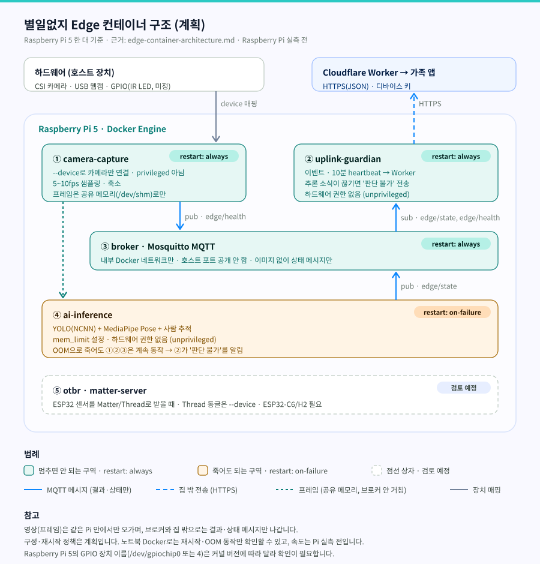

# 별일없지 — Edge SBC 컨테이너 구조

> 문서 버전 v1.1 · 작성일 2026-10-16 (v1.1: SBC·MCU 역할 나누기 절(1.1) 추가, 9장 ESP32 칩별 Thread 지원 확인)
> 관련 문서: [PRD](../PRD/PRD.md) · [SBC·MCU 부품 선정](sbc-mcu-selection.md) · [Edge 추론 엔진 선택](inference-engine-selection.md) · [하드웨어 부품 정리](hardware-parts.md) · [Vision 전처리·후처리 설계](vision-preprocessing-design.md)

> **현재 상태:** 구성 계획. Raspberry Pi 실측 전.
> 이 문서는 Edge 장치(Raspberry Pi 5) 안의 소프트웨어를 Docker 컨테이너로 어떻게 나눌지 정한 계획입니다. 아직 Pi에서 실행하지 않았고, 속도·메모리 수치는 쓰지 않습니다.

---

## 요약

| 항목 | 내용 |
|---|---|
| 목적 | 한 부분이 죽어도 가족에게 알리는 경로는 살아 있게 하기 (실패 격리) |
| 컨테이너 | ① camera-capture ② uplink-guardian ③ broker ④ ai-inference (+ ⑤ Matter/Thread 검토 예정) |
| 멈추면 안 되는 구역 | ①②③ — `restart: always` |
| 죽어도 되는 구역 | ④ — `restart: on-failure`, `mem_limit` 설정 |
| 메시지 | Mosquitto MQTT, 내부 Docker 네트워크만. 이미지 없이 결과·상태 메시지만 |
| 영상 | 같은 Pi 안 공유 메모리로만 전달. 브로커와 집 밖으로 보내지 않음 |
| 안전한 상태 | 추론이 멈추면 "이상 없음"이 아니라 **"Edge 판단 불가"를 알린다** |
| 남은 검증 | 노트북 Docker로 재시작·OOM 동작 확인, Pi 5에서 카메라 장치 연결·전체 동작 확인 (6장) |

---

## 1. 왜 나누는가

별일없지 Edge는 카메라 입력, 사람 검출·자세 추정, 클라우드 전송을 한 장치에서 합니다. 이 중 **추론은 메모리를 가장 많이 쓰고 가장 먼저 죽을 수 있는 부분**입니다. 한 프로그램으로 묶으면 추론이 죽을 때 전송과 heartbeat도 함께 멈춥니다.

별일없지에서 가장 위험한 실패는 **추론이 멈췄는데 가족 앱에는 "이상 없음"이 계속 보이는 것**입니다. 그래서 컨테이너를 나누는 기준은 다음 하나입니다.

> 추론이 죽어도, 가족에게 "지금은 판단할 수 없다"를 알리는 경로는 살아 있어야 한다.

별일없지에는 모터 같은 구동부가 없습니다. 따라서 로봇에서 말하는 "안전 정지"는 별일없지에서 **"판단 불가를 알린다"로** 바뀝니다.

### 1.1 왜 SBC에서 컨테이너로 나누고, MCU와는 어떻게 나누는가

| | SBC — Raspberry Pi 5 | MCU — ESP32-S3 |
|---|---|---|
| 하는 일 | 카메라 입력, 비전 AI, 상태 판단, 클라우드 전송 | 현관·화장실 PIR·도어 센서 읽기, 이벤트·heartbeat 전송 |
| 실행 환경 | 리눅스 위에 프로그램 여러 개 | OS 없이 펌웨어 하나 |
| 컨테이너 | **나눔** — 한 프로그램이 죽어도 다른 프로그램이 살아 있게 (실패 격리) | 나누지 않음 — 나눌 프로그램이 하나뿐 |
| 클라우드 경로 | ② uplink-guardian → Cloudflare Worker | Pi를 거치지 않고 Wi-Fi로 Cloudflare Worker에 직접 |

- **SBC에서 나누는 이유:** Pi 한 대가 카메라·추론·전송을 함께 하므로, 가장 먼저 죽을 수 있는 추론을 다른 부분과 떼어 놓아야 합니다(1장).
- **MCU와 나누는 방식:** 센서는 Pi 밖의 ESP32가 맡고 Worker로 바로 보냅니다. Pi 전체가 멈춰도 현관·화장실 신호는 계속 가고, 멈춘 장치는 heartbeat가 끊겨 OFFLINE으로 판정됩니다(3장).
- 부품을 고른 이유와 전환 조건은 [SBC·MCU 부품 선정](sbc-mcu-selection.md)에 정리했습니다.

---

## 2. 구조도



[원본 크기로 보기](../images/edge-containers.svg)

- Edge #1(거실·주방)과 Edge #2(침실)에 같은 구성을 각각 둡니다.
- 실선 파랑은 MQTT 메시지, 점선 파랑은 집 밖 전송(HTTPS), 점선 초록은 프레임(공유 메모리), 회색은 장치 매핑입니다.

---

## 3. 컨테이너별 역할

| 컨테이너 | 하는 일 | 하드웨어 권한 | 재시작 | 메모리 |
|---|---|---|---|---|
| ① camera-capture | 카메라에서 프레임을 읽고 5–10fps로 샘플링·축소(전처리 설계 1–3단계). 프레임은 공유 메모리에 둠. 자신의 상태를 `edge/health`로 발행 | 카메라 장치만 `--device`로 연결. `privileged` 쓰지 않음 | `always` | 제한 없음 (가벼움) |
| ② uplink-guardian | `edge/state`·`edge/health`를 구독해 상태 전환 이벤트와 10분 heartbeat를 Cloudflare Worker로 전송. 추론 결과가 일정 시간 오지 않으면 **"Edge 판단 불가"** 전송 | 없음 | `always` | 제한 없음 (가벼움) |
| ③ broker | Mosquitto MQTT. 컨테이너 사이 메시지 전달 | 없음 | `always` | 제한 없음 |
| ④ ai-inference | 공유 메모리의 프레임으로 YOLO(NCNN) 사람 검출 → 사람 추적 → MediaPipe Pose. 결과를 `edge/state`로 발행 | 없음 | `on-failure` | `mem_limit` 설정 (값은 Pi 실측 후 정함) |
| ⑤ otbr · matter-server | ESP32 센서를 Matter/Thread로 받을 때만 추가 (7장) | Thread 무선 동글을 `--device`로 연결 | 검토 예정 | 검토 예정 |

- **"판단 불가" 기준 시간**은 검증 전에 정합니다. 기준 시간이 짧으면 일시적인 재시작에도 알림이 가고, 길면 알림이 늦어집니다.
- **②가 죽는 경우**: Cloudflare Worker는 이미 heartbeat가 끊기면 기기를 OFFLINE으로 판정합니다(개발 레포 PoC, ESP32에서 검증). Edge도 같은 방식으로 heartbeat를 보내면 ②가 멈췄을 때 클라우드 쪽에서 알아챕니다. 이것이 마지막 안전망입니다.

---

## 4. 메시지 토픽

| 토픽 | 발행 | 구독 | 내용 |
|---|---|---|---|
| `edge/health` | ① camera-capture | ② uplink-guardian | 카메라 동작 여부, 마지막 프레임 시각 |
| `edge/state` | ④ ai-inference | ② uplink-guardian | 사람 유무·Zone·자세 등 추론 결과 (이미지 없음) |

- 토픽 이름과 메시지 칸은 구현할 때 확정합니다.
- 브로커는 **호스트 포트를 공개하지 않고** 내부 Docker 네트워크에서만 접근하게 둡니다.

---

## 5. 프라이버시 경계

| 데이터 | 다니는 범위 |
|---|---|
| 프레임(영상) | ① → 공유 메모리 → ④. **같은 Pi 안에서만**. 저장하지 않음 |
| 추론 결과·상태 | ④ → ③ → ② (Pi 안) |
| 상태 전환 이벤트·heartbeat | ② → Cloudflare Worker (집 밖, HTTPS) |

- 브로커에 이미지를 싣지 않으므로, 브로커 설정을 실수로 열더라도 영상은 나가지 않습니다.
- 집 밖으로 나가는 경로는 ②의 HTTPS 하나입니다.

---

## 6. 검증 계획

| 순서 | 확인할 것 | 장소 | 상태 |
|---|---|---|---|
| 1 | ④를 강제로 종료·메모리 초과시켰을 때 ①②③이 계속 동작하는지, ④가 다시 켜지는지 | 노트북 Docker (가짜 입력) | 진행 전 |
| 2 | ④가 멈춘 동안 ②가 "판단 불가"를 보내는지 | 노트북 Docker | 진행 전 |
| 3 | 브로커가 외부에서 접속되지 않는지 | 노트북 Docker | 진행 전 |
| 4 | 카메라를 `privileged` 없이 `--device`만으로 읽을 수 있는지 | Raspberry Pi 5 | 진행 전 |
| 5 | 전체 FPS·메모리, `mem_limit` 값 결정 | Raspberry Pi 5 | 실측 전 |

- 노트북(x86) 결과는 **구조 동작 확인용**이며, 속도·메모리는 Pi 실측으로 대신할 수 없습니다([Edge 추론 엔진 선택](inference-engine-selection.md) 5장과 같은 원칙).

---

## 7. Matter/Thread 검토 (검토 예정)

지금 ESP32 센서는 **Wi-Fi 2.4GHz + HTTPS(JSON)로** Cloudflare Worker에 직접 보냅니다([하드웨어 부품 정리](hardware-parts.md) 4장). Matter/Thread는 이 경로를 바꿀 때의 후보입니다.

| 항목 | 내용 |
|---|---|
| Matter | 브랜드가 달라도 스마트홈 기기끼리 통하게 하는 표준. Wi-Fi·Thread·이더넷 위에서 동작 |
| Thread | 저전력 IPv6 메시 무선망. 전지로 오래 가는 센서에 맞음 |
| 컨테이너 | Thread를 쓰려면 Pi에 Thread 보더 라우터(OTBR)와 Matter 컨트롤러가 필요. 각각 컨테이너로 두는 구성이 가능 |
| 걸리는 점 | **ESP32-S3에는 Thread 무선(IEEE 802.15.4)이 없음** → ESP32-C6/H2 같은 칩으로 바꿔야 함. Pi에도 Thread 무선 동글이 필요 |
| 지금 결정 | 적용하지 않음. 센서 전지 구동이 필요해지면 다시 검토 |

---

## 8. docker compose 초안 (실행 전)

구조를 설명하기 위한 초안입니다. 아직 실행하지 않았고, 이미지 이름·장치 경로는 구현할 때 확정합니다.

```yaml
services:
  broker:
    image: eclipse-mosquitto
    restart: always
    networks: [edge]            # ports 없음: 외부에 공개하지 않음

  camera-capture:
    build: ./camera-capture
    restart: always
    devices:
      - /dev/video0             # 실제 장치 경로는 Pi에서 확인
    ipc: shareable              # 프레임 공유 메모리
    networks: [edge]

  uplink-guardian:
    build: ./uplink-guardian
    restart: always
    env_file: .env              # 디바이스 키 (커밋하지 않음)
    networks: [edge, uplink]

  ai-inference:
    build: ./ai-inference
    restart: on-failure
    mem_limit: <Pi 실측 후 결정>
    ipc: "service:camera-capture"
    networks: [edge]

networks:
  edge:
    internal: true              # 내부 전용, 인터넷 연결 없음
  uplink: {}
```

- 개발 코드는 개발 레포 [Byeolileopji](https://github.com/namong118/Byeolileopji)에 둡니다.

---

## 9. 확인하지 못한 항목

- Docker 재시작 정책·`mem_limit`·`internal` 네트워크·`ipc` 설정의 정확한 동작 — Docker 공식 문서로 확인 필요
- Raspberry Pi 5 카메라(libcamera)를 컨테이너 안에서 `--device`만으로 쓸 때 필요한 장치 목록
- Raspberry Pi 5의 GPIO 장치 이름(`/dev/gpiochip0` 또는 `4`) — 커널 버전에 따라 다름
- ESP32 칩별 Thread 지원 — **확인함** (2026-10-16): ESP32-S3에는 802.15.4가 없고([ESP32-S3 데이터시트 v2.2](https://documentation.espressif.com/esp32-s3_datasheet_en.pdf)), ESP32-C6(Thread 1.3)·ESP32-H2(Thread 1.4)에는 있음([ESP32-C6 데이터시트 v1.5](https://documentation.espressif.com/esp32-c6_datasheet_en.pdf) · [ESP32-H2 데이터시트 v1.3](https://documentation.espressif.com/esp32-h2_datasheet_en.pdf)). [SBC·MCU 부품 선정](sbc-mcu-selection.md) 7장 출처 S6·E3·E4
- OTBR·Matter 서버의 컨테이너 배포 방식 — OpenThread·CSA 공식 문서로 확인 필요
- 이 문서의 내용은 이번에 출처를 다시 확인하지 않았습니다. 구현 전에 위 항목을 공식 문서로 확인하고 출처를 추가합니다.
