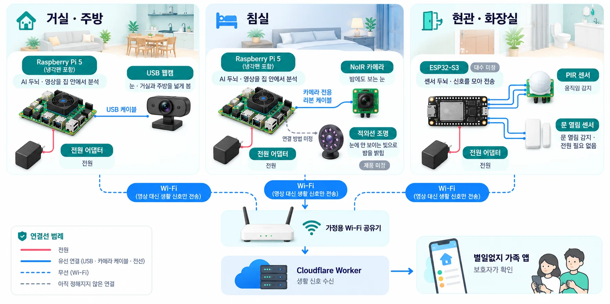
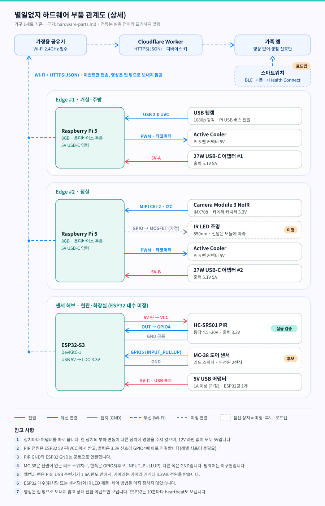

# 별일없지 — 하드웨어 부품 정리

> 문서 버전 v1.1 · 작성일 2026-10-14 (v1.1: 부품 관계도 추가)
> 관련 문서: [PRD](../PRD/PRD.md) · [Vision 전처리·후처리 설계](vision-preprocessing-design.md)

---

## 개요

가구 1세트에 들어가는 부품의 **공급 전압, 전류, 통신 방식**을 정리한 문서입니다.

- **근거:** PRD v1.2 4장 기술 스택 표와 6장 ROI 가정, 개발 레포 [Byeolileopji](https://github.com/namong118/Byeolileopji)의 `firmware/esp32-pir` README·`config.h`.
- **PRD에 없는 부품·값은 "(가정)"으로 표시**했습니다.
- **모든 전류 값은 실측 전입니다.** 전압·전류는 측정한 값이 아니라 공식 데이터시트·제조사 문서에서 옮긴 값이거나, 확인하지 못한 일반 사양입니다. 표의 **출처** 열에 어느 쪽인지 적었습니다.
  - 공식 문서로 확인한 값: 출처 기호(아래 표)
  - 확인하지 못한 값: **일반 사양, 확인 필요**
- 실기기로 검증한 것은 **ESP32-S3 + HC-SR501 PIR → GPIO4 → Wi-Fi → Cloudflare Worker → 앱 반영** 경로와 heartbeat 왕복뿐입니다(펌웨어 README 기준). 전원·전류는 이 검증 범위에 들어 있지 않습니다.

### 출처 목록

| 기호 | 문서 | 확인한 내용 |
|---|---|---|
| S1 | [Raspberry Pi 공식 문서 — Power supply](https://www.raspberrypi.com/documentation/computers/raspberry-pi.html#power-supply) | Pi 5 권장 전원 5.0A, USB 주변기기 합계 1.6A(3A 전원이면 600mA), 보드 단독 일반 동작 800mA, 팬 커넥터는 USB 주변기기와 같은 전류 한도를 나눠 씀 |
| S2 | [Raspberry Pi 27W USB-C Power Supply 제품 페이지](https://www.raspberrypi.com/products/27w-power-supply/) | 기본 출력 5.1V 5.0A (25.5W) |
| S3 | [Raspberry Pi Active Cooler 제품 페이지](https://www.raspberrypi.com/products/active-cooler/) | 5V DC, Pi 5의 4핀 팬 커넥터, PWM + 타코미터, 온도 제어. **전류는 표기 없음** |
| S4 | [Raspberry Pi 공식 문서 — Camera](https://www.raspberrypi.com/documentation/accessories/camera.html) | 카메라 커넥터가 3.3V를 공급, Pi 5는 22핀 mini 커넥터라 Standard–Mini 케이블 사용 |
| S5 | [Camera Module 3 Product Brief](https://datasheets.raspberrypi.com/camera/camera-module-3-product-brief.pdf) | Sony IMX708, CSI-2 출력, 2선 직렬(I2C) 제어, NoIR은 IR 차단 필터 없음, 동봉 케이블 15×1mm FPC 200mm. **전류는 표기 없음** |
| S6 | [ESP32-S3 Series Datasheet v2.2 (Espressif)](https://documentation.espressif.com/esp32-s3_datasheet_en.pdf) | 권장 입력 3.0–3.6V, 전원 공급 능력 0.5A 이상(표 5-2), Wi-Fi 송신 피크 340mA·수신 88–91mA(표 5-7, 3.3V·25°C 칩 기준), 내부 풀업 약 45kΩ(표 5-4) |
| S7 | [ESP32-S3-DevKitC-1 사용자 가이드 v1.1](https://docs.espressif.com/projects/esp-dev-kits/en/latest/esp32s3/esp32-s3-devkitc-1/user_guide_v1.1.html) | USB 포트 전원(권장) / 5V 핀 / 3V3 핀 중 하나만 사용, 보드에 5V→3.3V LDO |
| S8 | HC-SR501 판매처 배포 데이터시트 (제조사 공식 문서 없음) | 동작 전압 DC 4.5~20V, 대기 전류 50µA 미만, 출력 HIGH 3.3V / LOW 0V, 전원 인가 후 약 1분 초기화 |
| F1 | [Byeolileopji `firmware/esp32-pir` README·config.h](https://github.com/namong118/Byeolileopji/tree/main/firmware/esp32-pir) | 배선(VCC→5V, OUT→GPIO4), 피해야 할 GPIO, 2.4GHz 전용, 10분 heartbeat, 실기기 검증 범위 |

> HC-SR501은 여러 업체가 만드는 범용 모듈이라 제조사 공식 데이터시트가 없습니다. S8은 판매처가 배포하는 사양서이며, 같은 문서 안에서도 전원 전압을 "5V–20V"와 "DC 4.5–20V"로 다르게 적고 있습니다. 일부 판매처는 대기 전류를 65µA로 적습니다.

---

## 부품 관계도

가구 1세트의 부품이 서로 어떻게 연결되는지 그린 그림입니다. 1~4장의 표를 그림으로 옮긴 것이며, 전류는 실측 전이라 그림에 적지 않았습니다.

### 한눈에 보기

- 부품마다 역할을 쉬운 말로 적은 개념도입니다. **부품 모양은 예시**이며, 정확한 배선과 사양은 아래 상세 배선도와 이 문서의 표를 기준으로 합니다.

### 상세 배선

- **선 읽는 법:** 빨강 실선은 전원, 파랑 실선은 유선 연결(USB·CSI-2·GPIO·PWM), 회색 실선은 접지(GND), 파랑 점선은 무선(Wi-Fi), 회색 점선은 아직 정하지 않은 연결입니다. 점선 상자는 미정·후보·로드맵 부품입니다.

### 연결 요약

| 묶음 | 두뇌 | 연결된 부품 (연결 방식) | 전원 |
|---|---|---|---|
| Edge #1 · 거실·주방 | Raspberry Pi 5 | USB 웹캠 (USB 2.0 UVC), Active Cooler (PWM·타코미터) | 27W 어댑터 #1 → 5V-A |
| Edge #2 · 침실 | Raspberry Pi 5 | Camera Module 3 NoIR (MIPI CSI-2·I2C), Active Cooler (PWM·타코미터), IR LED 850nm (GPIO → MOSFET, 가정 · 제품 미정) | 27W 어댑터 #2 → 5V-B |
| 센서 허브 · 현관·화장실 | ESP32-S3 DevKitC-1 (대수 미정) | HC-SR501 PIR (VCC ← 5V 핀, OUT → GPIO4, GND 공통 · 실물 검증), MC-38 도어 센서 (GPIO5 후보 · INPUT_PULLUP, GND · 펌웨어 미구현) | 5V USB 어댑터 1A 이상 (가정) → 5V-C |
| 집 밖 | — | 세 묶음 → Wi-Fi 2.4GHz 공유기 → HTTPS(JSON) → Cloudflare Worker → 가족 앱. 스마트워치는 BLE → 스마트폰 → Health Connect → 앱 (로드맵 4단계) | — |

- 영상은 집 밖으로 보내지 않고 상태 전환 이벤트만 보냅니다. ESP32는 10분마다 heartbeat도 보냅니다.
- 개념도는 AI로 만든 그림이라 부품이 바뀌면 다시 만들어야 합니다. 내용이 다를 때는 이 문서와 상세 배선도를 기준으로 합니다.

---

## 1. 부품 목록 (가구 1세트)

| 부품 | 수량·위치 | 공급 전압 | 전류 (평균 / 피크) | 통신·인터페이스 | 근거 | 출처 (전압·전류) |
|---|---|---|---|---|---|---|
| Raspberry Pi 5 (8GB) | 2대: 거실·주방 Edge #1, 침실 Edge #2 | 5V USB-C | 보드 단독 일반 동작 800mA / 추론 부하 약 2A. 설계 상한은 주변기기 포함 5A | Wi-Fi → 클라우드, USB(웹캠), MIPI CSI(카메라) | PRD (가정) | 5V·5A·800mA: S1 / 추론 부하 2A: 일반 사양, 확인 필요 |
| Pi 5 공식 27W USB-C 어댑터 | 2개 | 출력 5.1V 5A | — | — | 5A 전원일 때만 USB 주변기기 합계 1.6A 허용 (3A 전원이면 600mA) (가정) | S1, S2 |
| Pi 5 Active Cooler | 2개 | 5V (Pi 5 팬 커넥터) | 약 0.1A 이하 | PWM 팬 제어 + 타코미터 | (가정) 지속 추론 시 발열 스로틀링 방지 | 5V·PWM: S3 / 전류: 일반 사양, 확인 필요 |
| USB UVC 웹캠 1080p 광각 | 1대: 거실·주방 (Edge #1) | 5V USB 버스 전원 | 약 0.2~0.5A (USB 2.0 포트 상한 0.5A) | USB 2.0 UVC | PRD | 일반 사양, 확인 필요 (제품 미정) |
| Camera Module 3 NoIR | 1대: 침실 (Edge #2) | 3.3V (카메라 커넥터로 Pi가 공급) | 약 0.2~0.3A | MIPI CSI-2 + I2C(설정). Pi 5 연결에는 22핀↔15핀 Standard–Mini 케이블 필요 | PRD (케이블은 가정) | 3.3V·CSI-2·I2C·커넥터: S4, S5 / 전류: 일반 사양, 확인 필요 |
| 850nm IR LED 조명 | 침실 | 모듈에 따라 3.3V / 5V / 12V | 모듈에 따라 수십~수백 mA | 상시 점등(조도 센서 내장형) 또는 GPIO → MOSFET 스위칭 | PRD (가정) | 일반 사양, 확인 필요 (제품 미정) |
| ESP32-S3 DevKitC-1 | 현관·화장실 센서 허브 (대수 미정, 5장) | 5V USB 입력 → 보드 LDO 3.3V 로직 | Wi-Fi 연결 유지 약 0.1A / 송신 피크 약 0.35A (칩 기준 340mA) | Wi-Fi 2.4GHz → HTTPS(JSON) → Cloudflare Worker | PRD, F1 (실기기 heartbeat 검증 완료) | 3.3V·LDO: S6, S7 / 송신 피크 340mA: S6 / 연결 유지 평균: 일반 사양, 확인 필요 |
| 5V USB 어댑터 1A 이상 | ESP32당 1개 | 5V | 데이터시트 권장 0.5A 이상에 여유를 두어 1A 이상 | — | (가정) | 0.5A 권장: S6 / 1A: (가정) |
| HC-SR501 PIR | 현관·화장실 | 4.5~20V (ESP32 보드 5V 핀에서 공급) | 대기 50µA 미만 | 디지털 출력 → GPIO4. 출력 HIGH 3.3V라 레벨 시프터 불필요 | PRD, F1 (실물 E2E 검증 완료) | S8, F1 |
| MC-38 마그네틱 도어 센서 | 현관·화장실 | 무전원 (리드 스위치) | 내부 풀업 기준 약 0.07mA (3.3V ÷ 45kΩ) | 디지털 입력 (`INPUT_PULLUP`) | PRD, GPIO 후보 5 (3장) | 풀업 저항값: S6에서 계산 |
| 스마트워치 | 로드맵 4단계, 이용자 보유 | 자체 배터리 | 가구 전원 예산에서 제외 | BLE → 스마트폰 → Health Connect → 앱 | PRD | — |
| 가정용 공유기 | 기존 장비 | — | — | 2.4GHz 필수 (ESP32는 5GHz 미지원) | F1 | — |

- ESP32-S3 송신 피크 340mA는 **칩 단독, 3.3V, 802.11b 21dBm, 송신 100% 듀티** 조건의 값입니다(S6 표 5-7). 보드 전체(LDO·USB 브리지·LED 포함)의 5V 쪽 전류는 확인하지 못했습니다.
- Pi 5 Active Cooler 전류는 공식 문서에 없습니다. 참고로 공식 케이스 팬은 5V에서 약 60mA입니다(S1). 팬 전류는 USB 주변기기 1.6A 한도를 함께 씁니다(S1).

---

## 2. 전원 라인

- 모터·펌프 같은 구동부가 없어 **12V 라인이 없고, 모든 장치가 5V**입니다. (IR LED를 12V 모듈로 고르는 경우만 예외이며, 이때는 별도 어댑터를 씁니다.)
- **장치마다 어댑터를 따로 씁니다.** 그래서 한 장치의 부하 변동(예: Pi 추론 부하, ESP32 송신 피크)이 다른 장치의 전압을 떨어뜨려 리셋시키는 문제가 구조적으로 생기지 않습니다.

| 라인 | 어댑터 | 연결 장치 | 비고 |
|---|---|---|---|
| 5V-A | 27W 어댑터 #1 (5.1V 5A) | Pi 5 #1, USB 웹캠, Active Cooler | 웹캠과 팬은 Pi의 USB 주변기기 1.6A 한도 안에서 공급 (S1) |
| 5V-B | 27W 어댑터 #2 (5.1V 5A) | Pi 5 #2, Camera Module 3 NoIR, Active Cooler, (IR LED) | 카메라는 카메라 커넥터 3.3V로 공급 (S4). IR LED가 수백 mA급이면 별도 공급 검토 |
| 5V-C… | 5V USB 어댑터 1A 이상 (ESP32당 1개) | ESP32-S3 DevKitC-1, HC-SR501 PIR | PIR은 보드 5V 핀에서 공급. **PIR GND와 ESP32 GND를 공통으로 연결** |

- **IR LED를 켜고 끌 때는 GPIO에 직접 연결하지 않고 MOSFET을 거칩니다.** GPIO는 신호만 보내고, LED 전류는 MOSFET이 전원 라인에서 직접 흘립니다. (가정, 상시 점등형을 쓰면 스위칭 불필요)
- ESP32-S3 DevKitC-1은 USB 포트 / 5V 핀 / 3V3 핀 전원 중 **하나만** 씁니다(S7). 별일없지는 USB 포트 전원을 씁니다.

---

## 3. ESP32-S3 핀 연결표

펌웨어 README·`config.h`(F1) 기준입니다.

| 센서 | 센서 핀 | ESP32-S3 DevKitC-1 | 상태 |
|---|---|---|---|
| HC-SR501 PIR | `VCC` | `5V` | 실물 검증 완료 |
| HC-SR501 PIR | `GND` | `GND` | 실물 검증 완료 |
| HC-SR501 PIR | `OUT` | `GPIO4` (`config.h`의 `PIR_PIN`) | 실물 검증 완료 |
| MC-38 도어 센서 | 리드 스위치 한쪽 | `GPIO5` (`INPUT_PULLUP`) | 후보 (펌웨어 미구현) |
| MC-38 도어 센서 | 리드 스위치 다른 쪽 | `GND` | 후보 (펌웨어 미구현) |

**사용하지 않는 GPIO** (F1):

| GPIO | 이유 |
|---|---|
| 0 / 3 / 45 / 46 | 스트래핑 핀 (부팅 모드 결정) |
| 19 / 20 | USB-JTAG (USB D− / D+) |
| 26~32 | SPI 플래시 |
| 33~37 | 옥탈 PSRAM (N16R8 보드) |
| 43 / 44 | UART0 (Serial 로그) |

- README가 적은 `PIR_PIN` 대안 핀은 **5, 6, 7, 15, 16, 17, 18**입니다. MC-38을 GPIO5에 두는 것은 이 대안 핀 중 하나를 고른 것이며, 펌웨어에는 아직 도어 센서 코드가 없습니다.
- HC-SR501은 전원 인가 후 약 60초 워밍업이 필요합니다(`PIR_WARMUP_MS`, S8).

---

## 4. 통신 구간표

| 구간 | 방식 | 고른 이유 |
|---|---|---|
| PIR·도어 센서 → ESP32 | 선 (디지털 GPIO) | 같은 기기 안에서 켜짐/꺼짐 신호만 전달 |
| 웹캠 → Pi #1 | 선 (USB 2.0 UVC) | 저가, 드라이버 호환성 |
| NoIR 카메라 → Pi #2 | 선 (MIPI CSI-2) | 영상은 데이터가 큼, IR 대응 |
| ESP32 → Cloudflare Worker | Wi-Fi 2.4GHz + HTTPS(JSON), 디바이스 키 | 이벤트와 10분 주기 heartbeat만 전송 |
| Pi → 클라우드 | Wi-Fi + HTTPS(JSON) | 영상은 보내지 않고 상태 전환 이벤트만 전송 |
| 스마트워치 → 앱 | BLE → 스마트폰 → Health Connect | 집 밖 걸음 활동만 사용 |
| 이더넷 | 선택 | 고정 설치라 가능하지만, 설치 편의상 Wi-Fi가 기본 |

---

## 5. 확인하지 못한 것

| 항목 | 상태 |
|---|---|
| 모든 장치의 실제 전류 | **실측 전** |
| ESP32 대수 | PRD 6장의 "ESP32 센서 4세트"가 위치당 1대(한 대가 PIR과 도어 센서를 함께 읽음)인지, 센서당 1대인지 문서에 없음. **미정** |
| Pi 5 추론 부하 전류 (약 2A) | 공식 문서에 부하별 값 없음. 일반 사양, 확인 필요 |
| Active Cooler 전류 | 공식 제품 페이지에 표기 없음. 일반 사양, 확인 필요 |
| Camera Module 3 NoIR 전류 | 공식 문서·Product Brief에 표기 없음. 일반 사양, 확인 필요 |
| USB 웹캠 전류 | 제품 미정. 일반 사양, 확인 필요 |
| IR LED 모듈 전압·전류 | 제품 미정. 검토 예정 |
| ESP32-S3 보드 전체 전류 | 데이터시트는 칩 단독 값만 있음. 보드 전체 5V 쪽 전류는 확인 필요 |
| HC-SR501 대기 전류 | 판매처 데이터시트 기준 50µA 미만, 일부 판매처는 65µA. 제조사 공식 문서 없음 |
| MC-38 정격 | 판매처 데이터시트 원문 확인 못 함. 신호 수준(풀업 약 0.07mA)으로만 쓰므로 정격과 무관할 것으로 봄 (판단, 측정 아님) |
| MC-38 배선·펌웨어 | GPIO5는 후보. 펌웨어 미구현, 실물 검증 전 |
| Pi 5 + 웹캠 + 팬의 USB 1.6A 한도 여유 | 실측 전 |
| 장기 안정성 (며칠 연속 운영) | 검증 전 (F1) |
