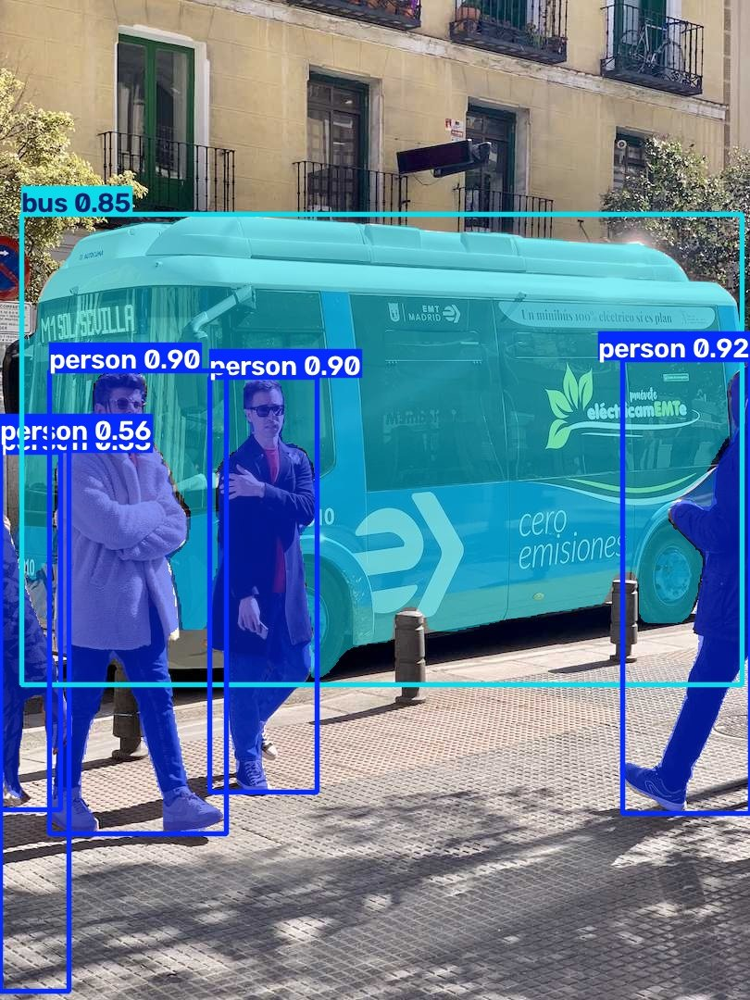
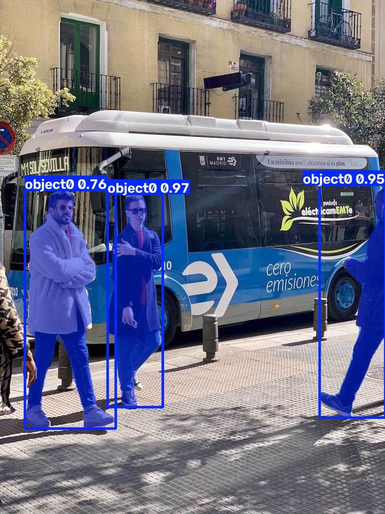
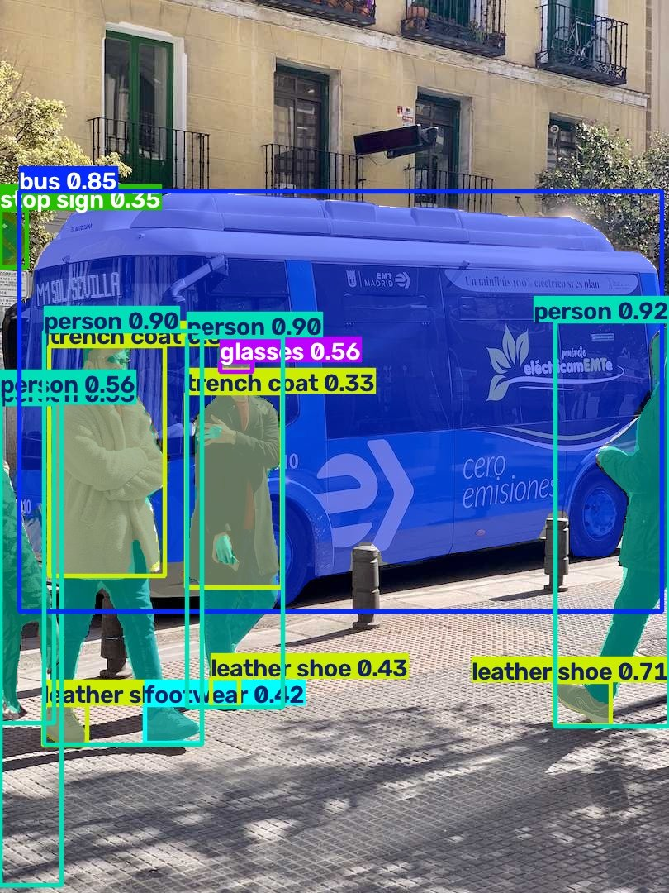
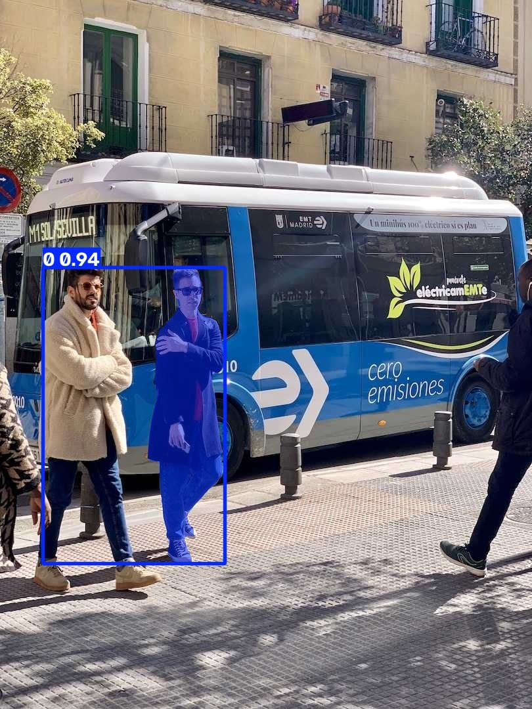
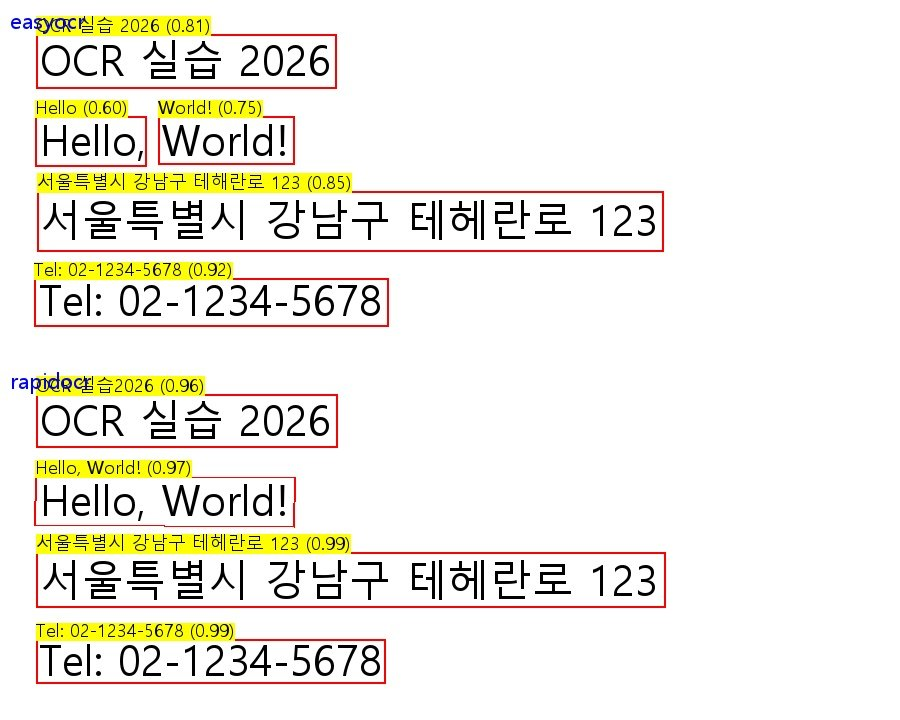
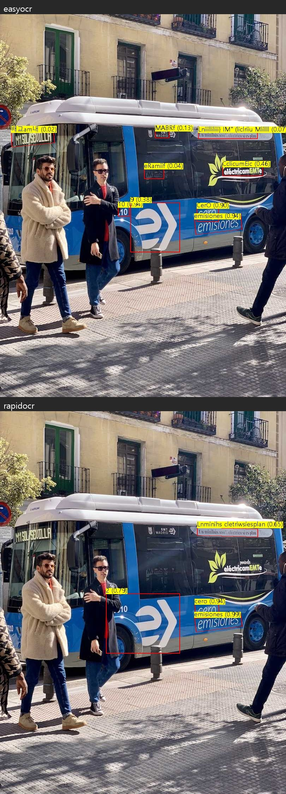
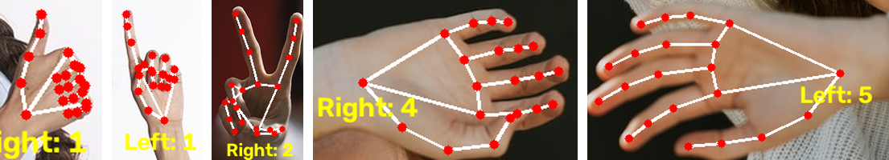

# 비전 모델 실습 보고서

> 문서 버전 v1.0 · 작성일 2026-10-12
>
> 실습일: 2026-10-12 · 일부 결과 재실행: 2026-10-12 15:59–16:00 (SigLIP, OCR — 재실행 결과에는 **[재실행]** 으로 표시)

---

## 1. 개요

여섯 가지 비전 모델의 기능과 사용 예시를 정리하고, 실습 폴더에서 실제로 실행한 내용과 결과를 함께 기록한 보고서입니다.

| 모델 | 한 줄 요약 | 이번 실습 |
|---|---|---|
| YOLOE | 글자·예시 박스·프롬프트 없이, 원하는 물체를 검출·분할 | 실행 (3가지 모드) |
| DINO-X | 개방형 물체 검출 (클라우드 API) | 직접 실행하지 않음 |
| SAM 3 / SAM 2.1 | 물체 영역(마스크) 분할 | SAM 2.1로 실행 |
| SigLIP | 이미지와 문장을 같은 공간의 벡터로 바꿔 유사도 비교 | SigLIP 2로 실행 (결과는 재실행 기록) |
| OCR | 이미지 속 글자 검출·인식 | EasyOCR, RapidOCR 실행 (CER·시간은 재실행 기록) |
| MediaPipe | 손 관절 21점 검출 | 손 랜드마크 + 손가락 개수 세기 |

**실습 환경** (실습 폴더에서 확인된 값)

| 항목 | 값 |
|---|---|
| OS | Windows |
| Python | 3.14.7 (가상환경) |
| 실행 장치 | CPU (`torch 2.14.1+cpu`, CUDA 사용 불가) |
| 주요 패키지 | ultralytics 8.4.175 · mediapipe 1.1.0 · easyocr 1.7.2 · rapidocr 3.10.0 · onnxruntime 1.31.0 · opencv-python 5.0.0.93 |
| SigLIP 실행 | 가상환경에 transformers가 없어 시스템 Python 3.14.7 + transformers 5.19.0으로 실행 |
| 사용한 가중치 | `yoloe-11s-seg.pt`, `yoloe-11s-seg-pf.pt`, `mobileclip_blt.ts`, `sam2.1_b.pt`, `google/siglip2-base-patch16-224`, `hand_landmarker.task` |

YOLOE·SAM·OCR 실습의 입력 이미지 `bus.jpg`는 **Ultralytics 공개 샘플 이미지**입니다.

---

## 2. 모델별 정리

### 2.1 YOLOE

**기능**
학습하지 않은 물체도 찾을 수 있는 개방형(open-vocabulary) 검출·분할 모델입니다. 찾을 대상을 세 가지 방식으로 지정합니다.
- 텍스트 프롬프트: 클래스 이름을 글자로 입력
- 비주얼 프롬프트: 이미지 위에 예시 물체를 박스로 표시 → 비슷한 물체를 찾음
- 프롬프트 프리: 아무것도 주지 않으면 모델의 내장 어휘로 보이는 물체를 찾음

**입력과 출력**
- 입력: 이미지·영상 + (클래스 이름 / 예시 박스 / 없음)
- 출력: 물체별 박스, 클래스 이름, 신뢰도, 분할 마스크

**실행 방식**: 로컬 실행 (Ultralytics 패키지)

**일반 사용 예시**
- 새 품목이 자주 바뀌는 매장 진열 점검처럼, 재학습 없이 찾을 대상을 바꿔야 하는 검출
- 데이터셋을 만들 때 라벨 초안 생성
- 로봇·자동화 장비가 이름으로 지정한 물체를 찾는 작업

**실습 내용** — `yoloe_modes.py`

```python
# 텍스트 프롬프트: 클래스 이름을 텍스트 임베딩으로 바꿔 등록
model = YOLOE("yoloe-11s-seg.pt")
model.set_classes(names, model.get_text_pe(names))      # names = ["person", "bus"]

# 비주얼 프롬프트: 예시 박스와 비슷한 물체 찾기
model.predict(src, visual_prompts=dict(bboxes=boxes, cls=cls),
              predictor=YOLOEVPSegPredictor)

# 프롬프트 프리: 내장 어휘를 가진 -pf 모델로 그냥 추론
YOLOE("yoloe-11s-seg-pf.pt").predict(src)
```

- 입력: `bus.jpg`, 신뢰도 임계값 기본값 0.25
- 결과: 모드별 결과 이미지 3장 (`runs/segment/predict`, `predict-2`, `predict-3`). 실행 명령과 콘솔 출력은 남아 있지 않아, 아래 수치는 결과 이미지에 표시된 값입니다.
- 모드 구분은 결과 라벨과 가중치 파일 다운로드 시각으로 판단했습니다.

**결과 이미지**

| 텍스트 프롬프트 (`person`, `bus`) | 비주얼 프롬프트 | 프롬프트 프리 |
|---|---|---|
|  |  |  |

*입력: Ultralytics 공개 샘플 이미지*

**실습에서 확인한 점**
- 텍스트 프롬프트: 지정한 두 클래스만 표시됨. bus 0.85, 사람 0.92 · 0.90 · 0.90. 왼쪽 가장자리에 일부만 보이는 사람은 0.56으로 낮고 라벨이 겹쳐 표시됨
- 비주얼 프롬프트: 클래스 이름 없이 `object0` 하나로 표시되며, 사람 3명을 찾음 (0.97 · 0.95 · 0.76). 버스와 왼쪽 가장자리의 사람에는 박스가 없음
- 프롬프트 프리: person·bus 외에 `trench coat`, `glasses`, `leather shoe`, `footwear`, `stop sign` 등 지정하지 않은 물체까지 표시됨. 왼쪽의 빨간 테두리 원형 표지는 `stop sign 0.35`로 표시됨

---

### 2.2 DINO-X

**기능**
개방형(open-world) 물체 검출 모델입니다. 글자 프롬프트, 예시 이미지 프롬프트, 또는 프롬프트 없이 이미지 속 물체를 찾습니다.

**입력과 출력**
- 입력: 이미지 + (글자 / 예시 / 없음)
- 출력: 물체별 박스, 이름, 신뢰도

**실행 방식**: 클라우드 API (이미지를 제공사 서버로 보내 결과를 받음)

**일반 사용 예시**
- 대량 이미지의 자동 라벨링
- 드물게 등장하는 물체(롱테일)까지 찾아야 하는 이미지 분석
- 이미지 검색·분류 서비스의 물체 태깅

**실습 내용**: 이번 실습에서 직접 실행하지 않음

**실습에서 확인한 점**: 해당 없음

---

### 2.3 SAM 3 / SAM 2.1

**기능**
SAM(Segment Anything Model)은 "무엇인지"보다 "어디까지가 한 물체인지"를 잘라내는(분할) 모델입니다.
- **SAM 3**: 글자(예: "노란 버스")나 예시 이미지로 **개념**을 지정하면, 그 개념에 해당하는 물체를 이미지·영상에서 **모두** 찾아 분할하고 영상에서는 추적합니다.
- **SAM 2.1**: 점·박스로 대상을 직접 지정하는 방식이며 글자 프롬프트는 받지 않습니다. 영상에서는 첫 프레임에 지정한 물체를 이후 프레임까지 따라가며 분할합니다.

**입력과 출력**
- 입력: 이미지·영상 + 프롬프트 (SAM 3: 글자·예시 / SAM 2.1: 점·박스)
- 출력: 물체별 분할 마스크 (영상에서는 프레임별 마스크와 물체 ID)

**실행 방식**: 로컬 실행 (이번 실습은 Ultralytics 패키지 사용)

**일반 사용 예시**
- 사진 편집의 배경 제거·물체 선택
- 의료·위성 영상 등에서 분할 라벨 작성 보조
- 영상 편집에서 특정 물체를 따라가며 효과 적용

**실습 내용** — `sam2_modes.py`

이번 실습은 **SAM 2.1 (`sam2.1_b.pt`)** 로 진행했습니다. 스크립트에는 점 / 박스 / 자동 분할 / 영상 추적 4가지 모드가 있습니다.

```python
model = SAM("sam2.1_b.pt")
model(src, points=[[[280, 600]]], labels=[[1]])          # 점 프롬프트 (1=포함, 0=제외)
model(src, bboxes=[[221, 405, 344, 857]])                # 박스 프롬프트
```

- 입력: `bus.jpg`
- 결과: 결과 이미지 1장 (`runs/segment/predict-4`). 자동 분할·영상 추적 결과물은 없음
- 실행 명령 기록이 없어 점·박스 중 어느 프롬프트로 실행했는지는 확정할 수 없습니다. 스크립트 기본값인 점 `280,600`과 박스 `221,405,344,857`은 모두 가운데 어두운 코트의 사람을 가리킵니다.

**결과 이미지**



*입력: Ultralytics 공개 샘플 이미지*

**실습에서 확인한 점**
- 마스크 1개가 가운데 어두운 코트를 입은 사람 한 명의 몸 윤곽을 따라 칠해짐 (표시값 `0 0.94`)
- YOLOE와 달리 클래스 이름 없이 번호(`0`)로만 표시됨
- 이미지에 함께 그려진 박스는 마스크보다 왼쪽으로 넓게(옆 사람까지) 그려짐

---

### 2.4 SigLIP

**기능**
이미지와 문장을 같은 공간의 벡터(임베딩)로 바꾸는 모델입니다. 두 벡터의 코사인 유사도로 "이 이미지가 이 문장과 얼마나 맞는가"를 비교합니다. 학습할 때 softmax 대신 sigmoid로 이미지-문장 쌍의 일치 여부를 학습하는 것이 특징입니다. 이번 실습은 SigLIP 2를 사용했습니다.

**입력과 출력**
- 입력: 이미지, 문장
- 출력: 이미지 임베딩, 문장 임베딩 (→ 코사인 유사도, sigmoid 일치 확률)

**실행 방식**: 로컬 실행 (Hugging Face transformers)

**일반 사용 예시**
- 문장으로 사진을 찾는 이미지 검색
- 학습 없이 후보 문장 중 가장 맞는 것을 고르는 제로샷 분류
- 멀티모달 언어 모델의 이미지 인코더

**실습 내용** — `siglip2_similarity.py`

```python
model = AutoModel.from_pretrained("google/siglip2-base-patch16-224")
text_emb  = model.get_text_features(**processor(text=texts, padding="max_length", max_length=64))
image_emb = model.get_image_features(**processor(images=images))
cos  = F.normalize(image_emb, dim=-1) @ F.normalize(text_emb, dim=-1).T
prob = torch.sigmoid(cos * model.logit_scale.exp() + model.logit_bias)
```

- 입력 이미지: COCO 검증 이미지 1장 (`000000039769.jpg`, 스크립트 주석: 소파 위 고양이 두 마리)
- 비교 문장: "a photo of two cats", "a photo of a dog", "a photo of a car", "a remote control on a couch"
- 원래 실습(10-12)의 출력은 남아 있지 않아(콘솔 출력만 하는 스크립트), 같은 스크립트를 다시 실행한 결과를 기록합니다.

**[재실행] 결과** (2026-10-12 15:59, CPU)

| 순위 | 문장 | 코사인 유사도 | sigmoid 확률 |
|---|---|---:|---:|
| 1 | a photo of two cats | +0.1286 | 9.23% |
| 2 | a remote control on a couch | +0.0860 | 0.08% |
| 3 | a photo of a dog | +0.0259 | 0.00% |
| 4 | a photo of a car | −0.0079 | 0.00% |

- 임베딩 크기: 문장 (4, 768), 이미지 (1, 768)
- 문장끼리의 코사인 유사도: 0.661 ~ 0.872

**실습에서 확인한 점**
- 이미지 내용과 맞는 "two cats" 문장이 1위, 무관한 "car" 문장이 꼴찌
- 코사인 유사도 값 자체는 작음(최대 0.13). 절댓값보다 문장 간 **순위**로 읽어야 함
- 1위 문장도 sigmoid 확률은 9.23%. softmax처럼 합이 100%가 되도록 나누지 않으므로, 확률값을 그대로 "정답 확률"로 읽으면 안 됨
- 서로 다른 내용의 문장끼리도 유사도가 0.66 이상으로 높게 나옴
- 실행 중 모델 설정(토큰 id) 관련 경고가 출력됐으나 결과는 정상 출력됨

---

### 2.5 OCR

**기능**
이미지 속 글자를 찾아(검출) 읽는(인식) 기술입니다. 보통 글자 영역 검출 → (방향 보정) → 글자 인식 순서로 동작합니다. 이번 실습은 무료 OCR 엔진을 비교했습니다.
- **EasyOCR**: PyTorch 기반 OCR 라이브러리
- **RapidOCR**: PaddleOCR의 PP-OCR 모델을 ONNX로 변환해 실행하는 라이브러리
- **Tesseract**: 별도 프로그램 설치가 필요한 OCR 엔진

**입력과 출력**
- 입력: 이미지
- 출력: 글자 영역(4점 좌표), 인식한 문자열, 신뢰도

**실행 방식**: 로컬 실행 (세 엔진 모두). 클라우드 OCR API도 있으나 이번 실습 대상은 아님

**일반 사용 예시**
- 종이 문서·영수증·명함의 디지털화
- 차량 번호판 인식
- 사진 속 간판·메뉴 글자 번역

**실습 내용** — `ocr_compare.py`

```python
# 모든 엔진 결과를 [(box, text, conf), ...] 로 통일해 비교
reader = easyocr.Reader(["ko", "en"])                    # EasyOCR
engine = RapidOCR(params={"Rec.lang_type": LangRec.KOREAN,
                          "Rec.ocr_version": OCRVersion.PPOCRV5, ...})   # RapidOCR (PP-OCRv5 한국어)
cer = edit_distance(pred, gt) / len(gt)                  # 공백 무시 Character Error Rate
```

- 입력 1: 정답을 아는 샘플 이미지를 스크립트가 생성 (4줄: `OCR 실습 2026` / `Hello, World!` / `서울특별시 강남구 테헤란로 123` / `Tel: 02-1234-5678`)
- 입력 2: `bus.jpg` (정답 없음 → CER 계산 안 함)
- 처리 시간은 1회 워밍업 후 1회 측정
- Tesseract는 설치되어 있지 않아 원래 실습과 재실행 모두 건너뜀 (`TesseractNotFoundError`)
- 원래 실습(10-12 14:32)의 결과 이미지는 있으나 CER·처리 시간 출력이 남아 있지 않아, 같은 스크립트를 다시 실행한 수치를 기록합니다. 인식 문자열·신뢰도는 원래 결과 이미지와 재실행이 같았습니다.
- 샘플 결과 이미지(14:32:13)는 스크립트 파일이 마지막으로 저장된 시각(14:32:23)보다 먼저 만들어져, 엔진 이름 표시 형식이 bus 결과 이미지(14:32:38)와 다릅니다.

**[재실행] 결과** (2026-10-12 16:00, CPU)

샘플 이미지 (정답 있음)

| 엔진 | 모델 로드 (s) | 추론 (s) | 검출 영역 수 | 평균 신뢰도 | CER |
|---|---:|---:|---:|---:|---:|
| EasyOCR | 5.19 | 1.376 | 5 | 0.785 | 3.85% |
| RapidOCR | 0.66 | 0.842 | 4 | 0.977 | 0.00% |

`bus.jpg` (정답 없음)

| 엔진 | 모델 로드 (s) | 추론 (s) | 검출 영역 수 | 평균 신뢰도 |
|---|---:|---:|---:|---:|
| EasyOCR | 5.22 | 3.502 | 9 | 0.431 |
| RapidOCR | 0.42 | 0.588 | 4 | 0.843 |

**결과 이미지**

샘플 이미지 (위: EasyOCR, 아래: RapidOCR)



`bus.jpg` (위: EasyOCR, 아래: RapidOCR)



*입력: Ultralytics 공개 샘플 이미지*

**실습에서 확인한 점**
- 샘플 이미지
  - EasyOCR: `테헤란로`를 `테해란로`로 읽었고, `Hello,`의 쉼표가 빠져 `Hello`와 `World!`를 따로 검출 → CER 3.85% (52자 중 2자)
  - RapidOCR: 4줄을 모두 맞게 읽음 (CER 0.00%). 단, `OCR 실습2026`처럼 공백 하나가 빠졌으며 CER은 공백을 무시하므로 수치에 반영되지 않음
  - 신뢰도: RapidOCR 0.96–0.99, EasyOCR 0.60–0.92
- `bus.jpg`
  - 두 엔진 모두 큰 글자 `emisiones`(EasyOCR 0.94 / RapidOCR 0.99)와 `cero`(EasyOCR `CerO` 0.90 / RapidOCR 0.94)는 읽음
  - 버스 위쪽의 작은 글씨는 두 엔진 모두 의미 없는 문자열로 읽음 (예: RapidOCR `Lnminihs cletriwsiesplan` 0.65)
  - EasyOCR은 신뢰도 0.02–0.13의 잘못된 인식 결과가 여러 개 있었음. 신뢰도 기준으로 걸러낼 필요가 있음
- 속도 (CPU, 1회 측정): 모델 로드는 RapidOCR이 약 0.4–0.7초, EasyOCR이 약 5.2초. 추론도 두 이미지 모두 RapidOCR이 더 빨랐음

---

### 2.6 MediaPipe (Hand Landmarker)

**기능**
MediaPipe는 기기 안에서 머신러닝 모델을 실행하는 Google의 도구 모음입니다. 이번 실습의 Hand Landmarker는 이미지·영상에서 손을 찾아 손마다 **관절 21점**의 좌표와 왼손·오른손 구분을 출력합니다.

**입력과 출력**
- 입력: 이미지 또는 영상 프레임 (RGB)
- 출력: 손마다 관절 21점 좌표(정규화된 x, y, z), 왼손/오른손 구분

**실행 방식**: 로컬 실행 (모델 파일 `hand_landmarker.task`를 기기에서 실행)

**일반 사용 예시**
- 손짓으로 화면을 조작하는 제스처 인터페이스
- AR 필터·가상 피팅의 손 추적
- 수어 인식 연구의 손 모양 입력

**실습 내용** — `hand_count.py`

MediaPipe가 준 관절 좌표로 **펴진 손가락 수를 규칙으로 계산**합니다 (손가락 개수 판단은 모델이 아니라 스크립트의 규칙).

```python
def count_fingers(lm):
    count = 0
    if dist(lm[4], lm[17]) > dist(lm[3], lm[17]):        # 엄지: 끝이 새끼 뿌리에서 더 멀면 펴짐
        count += 1
    for tip, pip in [(8, 6), (12, 10), (16, 14), (20, 18)]:
        if dist(lm[tip], lm[0]) > dist(lm[pip], lm[0]):  # 나머지: 끝이 손목에서 더 멀면 펴짐
            count += 1
    return count
```

- 설정: `num_hands=2`, 이미지 모드와 웹캠(영상) 모드 지원
- 입력: 손 사진 5장 (`test_hands/`)
- 결과: 결과 이미지 5장 (`test_hands/out/*_result.png`). `hand_count.py`는 결과를 화면 창에 띄우기만 하고 파일로 저장하지 않으므로, **이 결과 이미지를 만든 스크립트는 실습 폴더에 없습니다.**

| 사진 | 검출된 손 | 표시된 숫자 |
|---|---|---:|
| 엄지 위로 | 오른손 1 | 1 |
| 검지 위로 | 왼손 1 | 1 |
| 브이 | 오른손 2 | 2 |
| 엄지 아래로 | 오른손 1 | 1 |
| 양손 펼침 | 오른손 4 + 왼손 5 | **9** |

**결과 이미지**



*왼쪽부터 엄지 위로 · 검지 위로 · 브이 · 양손 펼침(오른손) · 양손 펼침(왼손). 사람이 드러나지 않도록 손 부분만 잘라 사용했고, "엄지 아래로" 결과는 손이 얼굴 앞에 있어 잘라도 얼굴 일부가 보여 제외했습니다.*

**실습에서 확인한 점**
- 5장 모두에서 손을 검출했고, 양손 사진에서는 두 손을 각각 왼손·오른손으로 구분함
- 엄지 위로 / 엄지 아래로는 엄지 하나만 펴진 것으로 세어 각각 1
- 손가락을 모두 편 양손 사진은 10이 아니라 **9**로 나옴 (오른손 4, 왼손 5)

---

## 3. 모델 비교

| 모델 | 기능 | 입력 | 출력 | 실행 방식 | 대표 활용 |
|---|---|---|---|---|---|
| YOLOE | 개방형 물체 검출·분할 | 이미지 + 글자 / 예시 박스 / 없음 | 박스, 클래스, 신뢰도, 마스크 | 로컬 | 재학습 없는 검출, 라벨 초안 |
| DINO-X | 개방형 물체 검출 | 이미지 + 글자 / 예시 / 없음 | 박스, 이름, 신뢰도 | 클라우드 API | 대량 자동 라벨링, 이미지 태깅 |
| SAM 3 / SAM 2.1 | 물체 영역 분할·영상 추적 | 이미지·영상 + 글자·예시(SAM 3) / 점·박스(SAM 2.1) | 마스크 (영상: 물체 ID) | 로컬 | 배경 제거, 분할 라벨 보조 |
| SigLIP | 이미지·문장 임베딩, 유사도 | 이미지, 문장 | 임베딩, 유사도 | 로컬 | 문장으로 이미지 검색, 제로샷 분류 |
| OCR | 글자 검출·인식 | 이미지 | 글자 영역, 문자열, 신뢰도 | 로컬 (클라우드 API도 있음) | 문서 디지털화, 번호판 인식 |
| MediaPipe | 손 관절 21점 검출 | 이미지·영상 | 관절 좌표, 왼손/오른손 | 로컬 (기기 안) | 제스처 인터페이스, AR |

---

## 4. 정리

- **찾기 / 자르기 / 비교하기 / 읽기 / 관절 잡기**로 역할이 나뉩니다. YOLOE·DINO-X는 "무엇이 어디에", SAM은 "어디까지가 한 물체", SigLIP은 "이미지와 문장이 얼마나 맞는지", OCR은 "무슨 글자인지", MediaPipe는 "손 관절이 어디에"를 출력합니다.
- **프롬프트 방식이 결과를 바꿉니다.** 같은 `bus.jpg`에서 YOLOE는 텍스트 프롬프트로는 지정한 두 클래스만, 프롬프트 프리로는 옷·신발·표지까지 표시했고, SAM 2.1은 지정한 한 사람만 분할했습니다.
- **모델 출력 위에 규칙을 얹으면 그 규칙의 한계가 결과에 드러납니다.** MediaPipe 실습의 손가락 개수는 스크립트 규칙으로 계산했으며, 손가락을 모두 편 사진이 9로 나왔습니다.
- **점수는 읽는 법을 알아야 합니다.** SigLIP의 코사인 유사도는 값이 작아도 순위가 의미 있고, sigmoid 확률은 합이 100%가 아닙니다. OCR 신뢰도가 매우 낮은 결과(0.02 등)는 걸러야 합니다.
- **CPU만으로도 여섯 중 실행한 다섯 모델 계열이 모두 동작했습니다.** OCR에서는 엔진에 따라 모델 로드·추론 시간 차이가 컸습니다(1회 측정).
- 직접 실행하지 않은 항목: DINO-X, SAM의 자동 분할·영상 추적, SAM 3, Tesseract.
